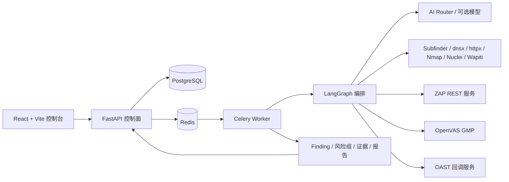

# 攻击面侦察与漏洞定位系统

这是一个本地优先、可离线运行的多引擎扫描项目。它把资产发现、端口探测、Web 扫描、API 契约检查、密钥检查和主机漏洞扫描归一化为统一的 Finding，并由 LangGraph 记录每个节点的状态与执行轨迹。

项目只面向明确授权的资产。前端在每次提交前显示扫描风险提示，必须勾选授权确认
才能创建任务。授权确认后可以填写任意公网域名或 URL，不再要求目标出现在固定
`AUTHORIZED_SCOPE` 白名单中。

没有登录要求的网站，将“登录配置 / Authentication ref”填写为 `none`。需要登录时
可选择固定认证档案，也可在前端选择“本次登录账号”并直接填写登录页、账号和密码，
无需为每个网站修改 YAML。扫描器保留 DNS 重绑定、内网元数据地址和扫描器输出外链
的基础防护；这些技术限制用于防止扫描器被当作任意网络代理。

专项评估使用本机私有授权文件，不把客户或学校目标写入通用模板：

```text
AUTHORIZATION_FILE=auth.local.yaml
```

`samples/auth.local.yaml` 应逐目标列出 scope 和允许的 IP/CIDR，并通过不同的
`auth_ref` 区分授权。该文件默认不进入版本控制。

面向老师或评审的完整交付摘要见 `DELIVERY_REPORT.md`，实测证据见
`ACCEPTANCE_REPORT.md`。

通用能力说明：

- `docs/auth-profiles.md`
- `docs/time-budgets.md`
- `docs/oast.md`

## 比赛提交材料

- 技术报告（29 页）：[PDF](docs/competition/攻击面侦察与漏洞定位系统-技术报告.pdf) / [Word](docs/competition/攻击面侦察与漏洞定位系统-技术报告.docx)
- 5-8 分钟演示视频讲解稿与分镜：[DEMO_VIDEO_SCRIPT.md](docs/competition/DEMO_VIDEO_SCRIPT.md)
- 大赛提交核对表：[COMPETITION_SUBMISSION_CHECKLIST.md](docs/competition/COMPETITION_SUBMISSION_CHECKLIST.md)
- 离线运行资源说明：[OFFLINE_RUNTIME_GUIDE.md](docs/competition/OFFLINE_RUNTIME_GUIDE.md)
- 给同学的 GitHub 上传步骤：[给同学的上传说明.md](给同学的上传说明.md)
- 完整项目说明书：[docs/project-manual](docs/project-manual)

## 团队信息

| 项目 | 信息 |
|---|---|
| 团队名称 | 我才是奶龙 |
| 学校 / 学院 | 待填写 |
| 团队成员 | 待填写 |
| 指导教师 | 待填写 |
| 参赛组别 | 待填写 |
| 评审专用账号 | 待填写（仅在线演示需要） |

提交前请将“待填写”替换为真实信息，并确认公开仓库中不包含 `.env`、API Key、账号密码或授权单位敏感信息。

## 技术架构



控制面和执行面分离。API 只负责 JWT、任务校验、入库和事件查询；Worker 执行 LangGraph 与扫描器。AI 只能在已通过授权和候选条件过滤的工具中选择下一个节点，模型不可用时回退固定安全顺序。

## 快速启动

前置条件：Docker Desktop 已启动，安装 Docker Compose v2。

Windows：

```powershell
cd D:\桌面\传智杯\attack-surface-scanner
.\start.bat
```

默认 `start.bat` 启动扫描系统、DVWA 和 Mock，不启动资源占用较大的 OpenVAS。
需要 OpenVAS 时，直接双击同目录下的：

```text
D:\桌面\传智杯\attack-surface-scanner\start-full.bat
```

也可以把 `.env` 中的 `OPENVAS_ENABLED` 设为 `true`，之后普通 `start.bat`
会自动叠加 `docker-compose.full.yml` 并拉起 OpenVAS。

`start-full.bat` 会叠加 `docker-compose.full.yml` 并启动 OpenVAS full profile。
首次启动需要拉取较大镜像并同步漏洞库，能力接口可能持续显示
`feed_not_synced` 或 `service_unreachable`，直到 OpenVAS 完成初始化。
OpenVAS 镜像自带基线 feed，可将 `OPENVAS_SKIP_SYNC=true` 设置为先启动服务、
稍后单独更新 feed；恢复在线同步时改回 `false`。

Linux / macOS：

```sh
./start.sh
```

首次启动会从 `.env.example` 创建 `.env`，并构建前后端、Worker、ZAP、DVWA 和 Mock。浏览器访问：

```text
http://127.0.0.1:3000
```

登录账号来自 `.env` 的 `ADMIN_USERNAME` 和 `ADMIN_PASSWORD`。默认是 `admin` / `admin`。
登录后默认进入安全态势总览；点击侧栏“新建扫描”进入任务配置。

### 可选 VAS 启动器

如果 VAS 是独立于本扫描控制台的本地启动器，请在 `.env` 中填写：

```dotenv
VAS_LAUNCHER=C:\path\to\VAS-Launcher.exe
VAS_STOPPER=
```

`VAS_LAUNCHER` 支持绝对路径（`.exe`、`.cmd`、`.bat`、`.ps1`）或
`http(s)://` URL。`start.bat` 和 `start-full.bat` 会在扫描服务就绪后启动它，
`stop.bat` 会优先执行可选的 `VAS_STOPPER`；未配置停止器时，会停止由启动脚本
记录 PID 的进程。Linux/macOS 的 `start.sh` 与 `stop.sh` 也支持同名配置。

DVWA：

```text
http://127.0.0.1:8081
```

首次打开 DVWA 后，如出现安装页面，点击 Create/Reset Database，再使用 `admin` / `password` 登录。系统提交的目标仍使用容器内地址 `http://dvwa`。

## 第一次任务

1. 登录前端，从总览点击“新建扫描”。
2. 阅读并勾选扫描风险与授权确认。
3. 没有登录要求的网站，登录配置填写 `none`，目标填写完整 URL。
4. 目标填写 `http://dvwa`，登录配置填写 `local-dvwa` 可运行本地靶场认证扫描。
5. 其他登录站点选择“本次登录账号”，填写登录页或 JSON 接口、账号和密码；系统会临时保存登录态，不需要编写认证档案。
6. 速率保持 `5`。
7. 模式选择 `active`，主动验证选择 `safe`；任务不设时间上限。
8. 提交并观察按实际执行顺序展开的数据流。只有进入执行链的工具会显示，未使用节点只汇总数量。

公网网站示例：

```text
目标：https://www.example.edu.cn/
登录配置：none
确认：勾选“我确认拥有该目标，或已取得明确授权”
```

扫描前应保留书面授权或资产归属证明。API 调用同样必须提交
`"authorization_confirmed": true`，否则返回 403。

条件边测试目标：

```text
http://mock:8000
```

授权引用使用 `local-mock`。Mock 暴露 `/swagger.json`、`/.git/config`、SQLi 参数和 6443 端口。没有 kubeconfig 时 `k8s_audit` 应显示为 skipped。

## 风险组、历史记忆与可选 AI

- 扫描结果先按 `host + port + vuln_type` 做确定性风险组聚合，完整保留每条 Finding、URL、证据哈希和工具来源。
- 对一个资产再次扫描时，系统读取最近 10 次资产快照，在任务页和报告中显示新增、持续和已消失的风险类型。
- `/history` 展示资产变化与任务记录；`/settings/ai` 可配置 OpenAI 兼容 API，默认关闭，也可填写本地兼容服务地址。
- API Key 使用由 `JWT_SECRET` 派生的 Fernet 密钥加密保存，读取接口只返回 `api_key_configured`，不回显明文。
- 开启 AI 后，模型会在已经通过授权、scope、mode 和 tool_profile 过滤的候选扫描器中选择下一个节点，`scan_decisions` 会记录每一步的选择来源、理由和置信度。
- AI 不能生成扫描命令、增加目标或调用候选列表之外的工具；未接入模型、AI 超时或返回非法节点时，自动回退固定安全顺序。
- 同一 host、port、vuln_type 内的语义归并和双语解读仍保留。AI 失败时 `llm_summarize` 标记为 `skipped`，扫描 Finding、确定性风险组和报告主链路不受影响，原始 Finding 不会被删除或修改。

默认推荐保持 `LLM_ENABLED=false`。真实 DeepSeek 连通性需要配置有效 Key；没有 Key 时仍可完成全部扫描、风险组、历史和报告功能。

## 服务与端口

| 服务 | 默认地址 | 说明 |
|---|---|---|
| 前端 | `http://127.0.0.1:3000` | React 控制台 |
| API | `http://127.0.0.1:8000` | FastAPI，文档在 `/docs` |
| DVWA | `http://127.0.0.1:8081` | 本地 Web 靶场 |
| Mock HTTP | `http://127.0.0.1:18000` | 容器内目标是 `http://mock:8000` |
| Mock 6443 | `127.0.0.1:16443` | 条件边测试 |
| OAST | `http://127.0.0.1:18001` | 本地回调验证服务 |

Worker 不映射端口。

ZAP、OpenVAS、Wapiti 和其他扫描器均不设置任务级或工具级时间上限。任务会持续运行，
直到全部工具完成或用户手动取消。

认证可由 `samples/auth.example.yaml` 中的固定 `authentication` 配置驱动，支持
form、json、cookie、Bearer 和 Basic；也可由前端提交本次任务的临时账号密码。临时
凭据使用 `JWT_SECRET` 派生密钥加密后写入带 TTL 的 Redis，Worker 使用后立即删除，
不会进入 PostgreSQL、任务响应、审计日志或报告。自动表单模式会识别登录页中的
用户名、密码、隐藏字段和提交地址。ZAP 和 Wapiti 都读取同一个会话对象，真实登录
失败时不会把未认证结果当作认证覆盖。
配置中的 `safe_path_denylist` 和 `active_scan_exclude` 用于排除退出、安装、重置
等会改变目标状态的路径。

项目不再使用 `time_profile`、`time_budget_seconds`、`stage_budgets` 或全局 deadline。
CLI 子进程、ZAP 与 OpenVAS 轮询、Wapiti 扫描和主动验证循环均不因时间到期而停止。

`validation_only` profile 可单独运行通用主动验证，不重复执行 ZAP/OpenVAS。
深度模式可启用 SQL 错误差分、低影响命令回显、无载荷危险扩展名上传检查，以及
可选的 OAST 回调验证（SSRF、XXE、盲命令执行）。

真实外部目标通常无法访问 Docker 内部的 `http://oast:8001`。此时必须把
`OAST_PUBLIC_BASE_URL` 设置为目标可达的 HTTPS 地址，并通过反向代理暴露 OAST
回调入口；`OAST_SECRET` 必须替换为随机值。

## 工具分工

| 工具 | 职责 |
|---|---|
| Subfinder | 被动子域发现 |
| dnsx | DNS 解析与存活确认 |
| httpx | HTTP 指纹、标题、技术栈 |
| Nmap | `-sT -sV -sC` 端口与服务识别 |
| Subjack | 子域接管指纹 |
| ZAP | Web 主动扫描，独立容器 |
| Nuclei | 已知 CVE/模板扫描 |
| Gitleaks | 前端资源密钥检查 |
| Schemathesis | OpenAPI 契约与属性检查 |
| Kubescape | 本地 K8s 配置基线 |
| Nikto | Web 服务器配置检查 |
| Wapiti | Web 参数与常见漏洞交叉验证 |
| OpenVAS/GVM | 主机与网络层 CVE 扫描；Worker 通过 `gvm-cli` 子进程调用，完整 profile |
| 通用验证器 | 登录会话分析、SQLi/命令注入/上传检查、可选 OAST 回调验证 |
| OAST | 独立回调服务，用于深度模式的盲 SSRF、XXE 和命令验证 |

所有工具版本固定在 Dockerfile 或 Compose 中。ZAP 和 OpenVAS 服务不安装进 Worker；
Worker 仅包含用于调用远程 GMP 的轻量 `gvm-cli`。

`python-gvm` 与 `gvm-tools` 是 GPL-3.0 组件。本项目只安装并执行 `gvm-cli`，
不 import 其源码；OpenVAS 自身也保持为独立容器服务。

任务 API 还支持 `tool_profile`：

- `full_agent`：默认，执行所有满足条件的分支。
- `nuclei`：只执行 Nuclei 扫描分支，用于消融对照。
- `zap_wapiti_nuclei`：执行 ZAP、Wapiti 和 Nuclei，用于多引擎对照。
- `validation_only`：只执行认证分析和通用主动验证，适合快速复测和真实环境回归。

未选中的分支会显示为 skipped，且不会调用相应外部工具。

## AI 动态扫描编排

- 未配置模型：`auth_gate -> 发现节点 -> router -> 固定顺序扫描 -> merge/report`。
- 已配置模型：每次扫描器结束后回到 `router`，AI 读取前一个扫描器结果、已有 Finding、端点和剩余候选工具，再选择下一节点或结束。
- 候选集合仍由确定性条件生成，例如只有发现 OpenAPI 才会出现 `api_fuzz`，只有 6443 才会出现 `k8s_audit`。
- 任务页按照真实执行顺序显示已经进入数据流的工具，不再预先铺开全部 19 张节点卡片。

## 启用 OpenVAS

OpenVAS 资源消耗大，首次启动需要同步漏洞库：

```powershell
docker compose -f docker-compose.yml -f docker-compose.full.yml --profile full --profile dvwa --profile mock up -d --build
```

然后以 `mode=full` 提交授权任务。OpenVAS 通过容器内 `openvas:9390` 使用 GMP。首次同步可能需要较长时间；服务、凭据或漏洞库未就绪时，`host_vuln_scan` 会明确显示 skipped/unavailable，不会阻塞其他扫描节点。

single-container 镜像默认把 GMP 放在 Unix socket。项目通过
`scripts/openvas-entry.sh` 启动镜像，并用 TLS 代理开放 `openvas:9390`；Worker
只读挂载 OpenVAS 数据卷中的 CA 证书。当前已验证 GMP 22.7、10 个扫描配置和
2 个 scanner 可读取。

如果不需要 OpenVAS，保持 `OPENVAS_ENABLED=false` 并使用默认 Compose 即可。
Windows 使用 `start-full.bat` 时会自动启用 `OPENVAS_ENABLED=true` 并启动 full profile。

## 离线包

在有网络的 AMD64 主机生成离线包：

```sh
./scripts/make_offline_bundle.sh offline-bundle
```

将项目、`.env.example` 和离线包带到目标机后执行：

```sh
./scripts/load_offline_bundle.sh offline-bundle
```

Windows PowerShell 可直接使用等价脚本：

```powershell
.\scripts\make_offline_bundle.ps1 -BundleDir offline-bundle
.\scripts\load_offline_bundle.ps1 -BundleDir offline-bundle
```

离线包包含前后端、Worker、ZAP、PostgreSQL、Redis、DVWA 和 Mock 镜像，并生成
`SHA256SUMS` 与 `VERSION`。需要把 OpenVAS 一并带走时，在 Windows 上使用
`.\scripts\make_offline_bundle.ps1 -BundleDir offline-bundle -IncludeOpenVAS`。
OpenVAS 体积较大且首次启动需要同步漏洞库，但加载脚本会自动载入同目录的
`openvas.tar`，默认 Compose 不会主动启动它。

## JWT 与能力接口

登录取 token：

```powershell
$body = @{ username = "admin"; password = "admin" } | ConvertTo-Json
$login = Invoke-RestMethod -Method Post -Uri http://127.0.0.1:8000/api/auth/login -ContentType application/json -Body $body
$headers = @{ Authorization = "Bearer $($login.access_token)" }
```

查询工具能力：

```powershell
Invoke-RestMethod -Uri http://127.0.0.1:8000/api/capabilities -Headers $headers
```

查询通用认证档案（只返回非敏感元数据）：

```powershell
Invoke-RestMethod -Uri http://127.0.0.1:8000/api/auth-profiles -Headers $headers
```

提交任务：

```powershell
$task = Invoke-RestMethod -Method Post -Uri http://127.0.0.1:8000/api/tasks -Headers $headers -ContentType application/json -Body (Get-Content -Raw samples/sample_task.json)
$task.id
```

## 状态与错误定位

- 工作流 PNG 采用“信息收集、认证与路由、扫描引擎、汇总报告”四段式布局；
  完成节点为绿色、运行中为蓝色、失败为红色、等待为黄色、跳过为虚线灰色。
- Worker 镜像内置开源文泉驿微米黑字体，避免 Mermaid PNG 中的中文显示为方框。
- 任务页卡片来自数据库状态轮询和 SSE 事件合并。
- 适配器异常会进入 `execution_trace` 和 `state.errors`。
- 缺失工具会使节点 `skipped`，不会伪造 Finding。
- 报告中的 PNG 使用带 JWT 的 fetch 下载；PNG 不可用时前端用本地 mermaid 包渲染 `.mmd`。

历史报告可按 `report.json` 中的执行轨迹和节点状态重新生成工作流图：

```powershell
docker compose exec -T worker python /app/scripts/regenerate_workflows.py
```

只刷新一个任务：

```powershell
docker compose exec -T worker python /app/scripts/regenerate_workflows.py --task-id <task-id>
```

查看日志：

```powershell
docker compose logs -f backend worker zap
```

## 测试与静态校验

```powershell
docker compose config
docker compose -f docker-compose.yml -f docker-compose.full.yml config
docker compose --profile test run --rm tests
python scripts/acceptance.py
```

当前自动化测试基线为 `66 passed`。AI 配置、密钥保护、历史资产 API、风险组去重、
双语报告和 AI 失败降级均有独立测试；真实 DeepSeek 调用不在默认离线测试链路中。

复现 3×3 消融实验：

```powershell
python evaluation/run_ablation.py --repetitions 3 --task-timeout 2400
```

实测结果和指标口径见 `docs/evaluation.md`。

如果本机已安装 Python 测试依赖，也可以：

```powershell
python -m pip install -r backend/requirements-dev.txt
python -m pytest
```

## 停止

```powershell
.\stop.bat
```

或：

```sh
./stop.sh
```

停止但保留数据库和输出数据。需要清空数据时，先确认不再需要报告，再执行 `docker compose down -v`。

清理过期证据：

```powershell
python scripts/cleanup_evidence.py --days 30 --dry-run
```

更新可选 EPSS/CVSS 离线缓存：

```powershell
python scripts/update_threat_intel.py --cves CVE-2024-0001
```

## 目录说明

```text
backend/app/adapters/    统一扫描适配器
backend/app/graph/       LangGraph 状态机
backend/worker/          Celery 执行入口
frontend/src/            控制台
mock/                    条件边本地目标
samples/                 授权与任务示例
tests/                   门禁、模型和解析器测试
```

## 安全说明

- 默认配置仅用于本机实验，不应直接暴露到公网。
- 正式使用前必须修改 `.env` 中的数据库密码、JWT 密钥、管理员密码和 OpenVAS 密码。
- 系统不进行漏洞利用、口令爆破、持久化或横向移动。
- 扫描结果包含目标响应时，应按组织的数据治理要求保存和清理。
- 当前版本未实现公网 HTTPS、租户级 RBAC、分布式限流和 ARM64 验证，边界详见
  `SECURITY_BOUNDARIES.md`。
- 本机没有可用 DeepSeek Key，因此已完成 API 配置、加密、错误降级和 mock 调用测试，
  但没有声称完成真实 DeepSeek 生成质量验收。
